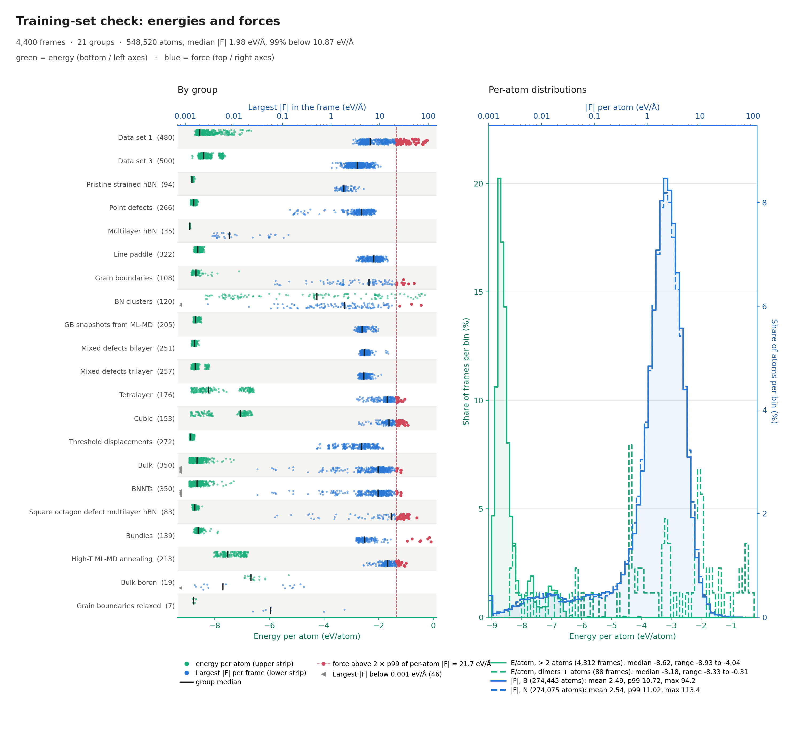

# dataset_check

A quick sanity check of the energies and forces in a training set for a machine-learned
interatomic potential.

One command reads `train.xyz`, prints summary tables and the frames worth a closer
look, and saves one figure with data groups on the left and the overall energy and
force distributions on the right.



## Why

Before training a potential it pays to look at the data:

- frames with a missing energy or missing forces,
- data groups whose energies sit somewhere unexpected,
- a few frames with enormous forces that can dominate the force loss,
- relaxed structures, dimer curves and condensed-phase frames mixed in one file.

`dataset_check.py` shows all of this in one pass, per data group.

## Requirements

- Python 3.8+
- `numpy`
- `matplotlib`

```bash
pip install numpy matplotlib
```

## Usage

```bash
python dataset_check.py train.xyz
python dataset_check.py train.xyz test.xyz            # several files are combined
python dataset_check.py train.xyz --top 15 --out check.pdf
python dataset_check.py train.xyz --outliers          # also flag energy outliers
python dataset_check.py train.xyz --frame-stat rms    # RMS force per frame instead of the largest
python dataset_check.py train.xyz --names group_names.txt   # your own group labels
```

| Option | Default | Meaning |
|---|---|---|
| `files` | — | one or more extended XYZ files |
| `--top N` | `10` | length of the "highest energy" and "largest force" lists |
| `--out FILE` | `dataset_check.png` | name of the figure (`.png`, `.pdf`, `.svg` …) |
| `--frame-stat` | `max` | force per frame in the by-group panel: `max` (largest \|F\|), `rms` or `mean` (see below) |
| `--names FILE` | — | display names for the groups (see below) |
| `--raw-names` | off | label groups with their `Config_type` prefix exactly as written |
| `--outliers` | off | flag frames whose energy per atom is far from their group (see below) |

## Input format

Standard extended XYZ: one frame is the atom count, a comment line with `key=value`
pairs, then one line per atom.

```
24
lattice="10 0 0 0 10 0 0 0 10" energy=-210.53 Config_type="04_point_defects/str-012" properties=species:S:1:pos:R:3:forces:R:3
B   0.000  0.000  0.000   0.1234 -0.0456  0.0012
N   1.446  0.000  0.000  -0.0981  0.0230 -0.0007
...
```

Recognized keys (any capitalization):

| What | Keys |
|---|---|
| total energy (eV) | `energy`, `REF_energy`, `DFT_energy`, `free_energy` |
| forces (eV/Å), column in `properties` | `forces`, `force`, `REF_forces`, `DFT_forces` |
| group label | `Config_type` |

**Groups.** Frames are grouped by the part of `Config_type` before the first `/`, so
`Config_type="18_bundles/str-47-00-99"` belongs to group `18_bundles`. Frames without
`Config_type` are grouped by file name. Groups are listed in natural order (`01_…`,
`02_…`, …, `10_…`).

## Output

### Terminal

```
4400 frames read, 21 groups
frames with missing energy: 0
frames with missing forces: 0

group labels used in the figure:
  01_ds1                         -> Data set 1
...

=== energy per atom ===
  all frames                     n=  4400  mean=   -8.352  std=  0.915  min=   -8.933  max=   -0.310  eV/atom
  01_ds1                         n=   480  mean=   -8.335  std=  0.417  min=   -8.723  max=   -6.668  eV/atom
...

highest E/atom (top 10):
     -0.310 eV/atom  n=   1  frame   2951  train.xyz / 08_bn_clusters/str-b-atom-001
...

=== |F| per atom ===
  all n=  548520  mean=  2.51  median=  1.98  p99= 10.87  max= 113.38  eV/A
  B   n=  274445  mean=  2.49  median=  1.99  p99= 10.72  max=  94.16  eV/A
  N   n=  274075  mean=  2.54  median=  1.97  p99= 11.02  max= 113.38  eV/A

frames with the largest single-atom force (top 10):
     113.38 eV/A on N   n= 144  frame   3994  train.xyz / 18_bundles/str-47-00-99
...
```

Every listed frame shows its index in the file, the file name and its full `Config_type`,
so you can go straight to the DFT folder it came from.

### Figure

One figure, two panels. Each panel holds two quantities on separate axes, colour-coded:
**green = energy** (bottom and left axes), **blue = force** (top and right axes).

| Panel | Shows | What to look for |
|---|---|---|
| **Left: by group** | one row per group, split in two strips. Upper strip: energy per atom of every frame (bottom axis). Lower strip: force of every frame (top axis, log), by default the largest \|F\| in the frame. Black tick = group median; red = force above the dashed threshold; ◂ = below 0.001 eV/Å | groups centred in the wrong place; a group split into two clouds; which groups contain the extreme-force frames; groups of relaxed structures |
| **Right: per-atom distributions** | energy per atom of all frames (bottom/left axes; > 2 atoms solid, dimers and atoms dashed) and \|F\| per atom (top/right axes, log; B solid, N dashed). Each curve is normalized to its own count; key statistics are in the legend | the overall energy range; a long tail of large forces; a spike in the first force bin (many near-zero forces) |

If the energies include strongly repulsive dimer points (above +10 eV/atom), the energy
axes switch to linear within ±10 eV/atom and logarithmic beyond, so the dimer walls fit
without flattening everything else. The figure height grows with the number of groups,
and the name column widens to fit the longest group name.

## Force per frame (`--frame-stat`)

The lower strip of the by-group panel shows one force value per frame:

| `--frame-stat` | Value | Red threshold | Use it for |
|---|---|---|---|
| `max` (default) | largest \|F\| on any atom | 2 × p99 of all per-atom \|F\| | finding bad frames: one broken atom is enough to stand out |
| `rms` | √(mean \|F\|²) over the atoms | 2 × p99 of the per-frame RMS values | comparing how far from equilibrium the groups are |
| `mean` | mean \|F\| over the atoms | 2 × p99 of the per-frame mean values | same as `rms`, less weight on the largest forces |

The largest force is the usual choice for data cleaning and active learning (for example
DP-GEN selects frames by the maximum force deviation). An average dilutes a few bad atoms
into many normal ones: a frame with one atom at 113 eV/Å among 143 ordinary ones has a
mean \|F\| of only about 4.5 eV/Å. With `rms` or `mean`, the terminal output also lists
the frames with the highest value of that statistic.

## Energy outliers (`--outliers`)

Off by default. When switched on, for every group with at least 5 frames of more than
2 atoms:

1. take the median energy per atom of the group,
2. measure the spread as the median absolute deviation (MAD × 1.4826, a robust stand-in
   for the standard deviation),
3. flag frames with |E/atom − median| > max(6 × spread, 0.15 eV/atom).

Flagged frames are listed in the terminal and drawn red in the energy strip of the
by-group panel, and their group name turns red.

Dimers and isolated atoms (≤ 2 atoms) are never flagged, because a dimer curve spreads
over many eV by design.

**Limitation.** The test assumes each group holds one kind of structure. If a group
mixes two populations, for example different B:N ratios, surfaces next to bulk, or
high-temperature snapshots next to relaxed ones, the smaller population is flagged as a
block even when the data are correct. Energy per atom depends strongly on composition, so
treat flags as "look at this", not "delete this".

## What the script does not check

The script looks at the numbers in the file. It cannot tell whether the DFT behind them
is right. Before trusting the forces, also:

- compare a few frames with the `TOTAL-FORCE` block of their OUTCAR (same ionic step,
  same atom order, eV/Å);
- check the `total drift` line in OUTCAR, which should be well below 0.01 eV/Å;
- make sure every SCF loop converged (no run stopped at `NELM`);
- look at the shortest interatomic distance in the frames with the largest forces;
  contacts far below normal bond lengths usually mean an unphysical structure, and
  overlapping PAW spheres make the DFT itself unreliable there.